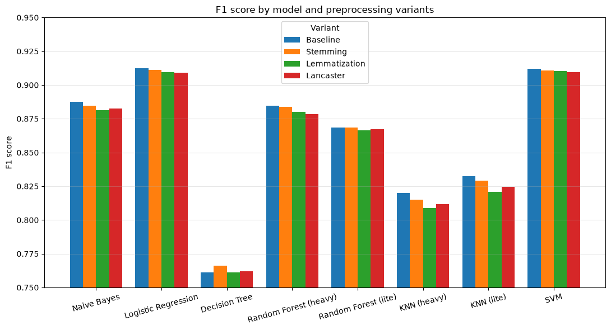
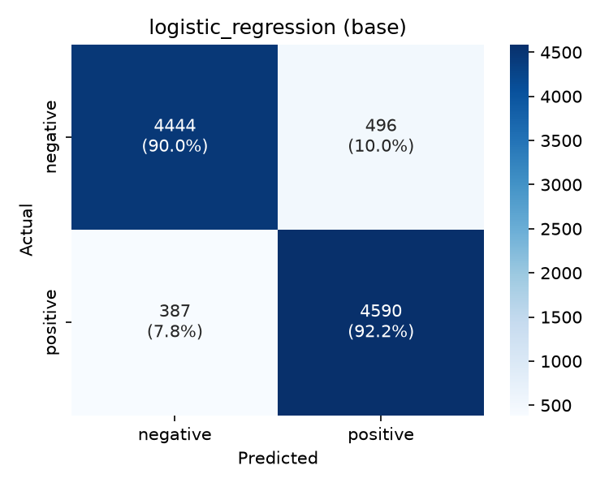
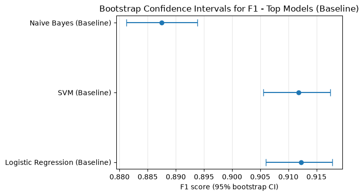
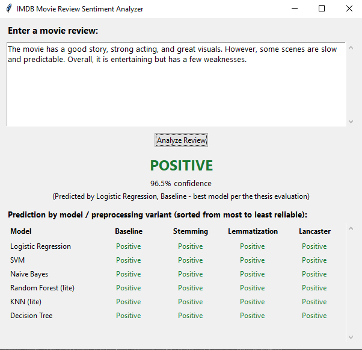

# Sentiment Analysis of Movie Reviews Using Classical Machine Learning

Bachelor's thesis project, School of Electrical Engineering, University of Belgrade.

A systematic comparison of six classical machine learning models for binary sentiment classification of IMDB movie reviews, combined with a controlled study of four text preprocessing variants. Every model is trained and evaluated under identical conditions (same split, same TF-IDF representation, same metric for hyperparameter selection), and the reliability of the results is checked with a McNemar test and bootstrap confidence intervals.

- **Author:** Marko Dasic
- **Mentor:** Assoc. Prof. Vladimir Jocovic, PhD
- **Thesis:** *Sentiment Analysis of Movie Reviews Using Machine Learning Methods* (Belgrade, 2026)

> 📄 **Full write-up:** this README is a summary. The complete theoretical background (how each model works, why each hyperparameter grid was chosen), per-model analyses, statistical checks and a discussion of limitations are in the thesis: [`bachelors_thesis.pdf`](bachelors_thesis.pdf)

**Try it:** download `predict_review.exe` from [Releases](https://github.com/MarkoD0/Movie-Review-Sentiment-Analysis/releases) (Windows), or run `python predict_review.py` after [setting up the environment](#-getting-started).

---

## Contents

- [🎯 Highlights](#-highlights)
- [📊 Results](#-results)
- [🔄 Pipeline](#-pipeline)
- [📂 Repository structure](#-repository-structure)
- [📦 What is not in the repository](#-what-is-not-in-the-repository)
- [🚀 Getting started](#-getting-started)
- [🧪 Reproducing the experiment](#-reproducing-the-experiment)
- [💻 GUI application](#-gui-application)
- [🔬 Methodology in detail](#-methodology-in-detail)
- [🚧 Limitations](#-limitations)
- [✅ Conclusions](#-conclusions)
- [🔭 Future work](#-future-work)
- [📚 Dataset](#-dataset)

---

## 🎯 Highlights

- **32 model x preprocessing combinations** evaluated on one shared test set: 6 model families x 4 preprocessing variants, plus compact "lite" versions of Random Forest and KNN (8 models x 4 variants).
- **Best result:** Logistic Regression on cleaned, unnormalized text, F1 = **0.9123**. Linear SVM is statistically indistinguishable from it (F1 = 0.9118; McNemar p = 0.79).
- **Extra complexity did not pay off.** Random Forest and KNN did not beat the linear models, and were beaten even by Naive Bayes, while costing up to ~15 hours of training and up to several GB of disk space.
- **Word normalization gave no measurable benefit.** Stemming, lemmatization and aggressive (Lancaster) stemming did not improve on the baseline; differences between variants are small relative to the uncertainty of a single test split.
- **Negation-aware preprocessing:** negation words are kept out of the stop-word list and bigrams are used, and the learned coefficients show that negation phrases such as "not funny" and "not recommend" are among the strongest negative features.
- **Lite models:** dedicated searches that measure F1 *and* file size found Random Forests of ~8-10 MB (instead of ~200 MB - 6.4 GB) at a cost of ~0.011-0.016 F1, and KNN models of ~1-1.4 MB (instead of ~1.5 GB) that scored *higher* than the heavy versions.
- **Desktop GUI** that classifies any pasted review and shows how every model and preprocessing variant votes.

---

## 📊 Results

All numbers are measured on the same held-out test set of 9,917 reviews (fixed 80/20 stratified split, `random_state=1`).

### F1 by model and preprocessing variant

| Model | Baseline | Snowball stemming | Lemmatization | Lancaster stemming |
|---|:---:|:---:|:---:|:---:|
| **Logistic Regression** | **0.9123** | 0.9112 | 0.9096 | 0.9091 |
| **SVM** (LinearSVC) | 0.9118 | 0.9109 | 0.9102 | 0.9097 |
| Naive Bayes | 0.8875 | 0.8846 | 0.8813 | 0.8824 |
| Random Forest (heavy) | 0.8848 | 0.8838 | 0.8801 | 0.8786 |
| Random Forest (lite) | 0.8686 | 0.8685 | 0.8666 | 0.8673 |
| KNN (lite) | 0.8324 | 0.8292 | 0.8208 | 0.8245 |
| KNN (heavy) | 0.8200 | 0.8150 | 0.8090 | 0.8118 |
| Decision Tree | 0.7613 | 0.7662 | 0.7611 | 0.7618 |



### Best model in detail

Logistic Regression, baseline variant: accuracy 0.9110, precision 0.9025, recall 0.9222, F1 0.9123.

<p align="center">

</p>

### Are the differences real?

| Comparison | Test | Result |
|---|---|---|
| Logistic Regression vs SVM (baseline) | McNemar exact test | p = 0.7877, no significant difference |
| Logistic Regression vs Naive Bayes (baseline) | McNemar exact test | p < 0.0001, significant difference |

95% bootstrap confidence intervals for F1 (2,000 resamples of the test set):

| Model (baseline) | F1 | 95% CI |
|---|:---:|:---:|
| Logistic Regression | 0.9123 | [0.9060, 0.9178] |
| SVM | 0.9118 | [0.9055, 0.9175] |
| Naive Bayes | 0.8875 | [0.8812, 0.8938] |

<p align="center">

</p>

The eight best combinations (all Logistic Regression and SVM) span only about 0.003 F1 (0.9123 to 0.9091) and should be read as one practically equivalent group, not as a ranking.

### Practical cost (average over the four variants)

| Model | Training time (GridSearchCV) | Saved model size |
|---|---|---|
| Naive Bayes | ~15 s | ~2 MB |
| SVM | ~1.4 min | ~0.5 MB |
| Logistic Regression | ~2.4 min | ~0.5 MB |
| Decision Tree | ~20 min | ~45 KB |
| KNN (heavy) | ~1.9 h | ~1.5 GB |
| Random Forest (heavy) | ~14.6 h | ~200 MB (6.4 GB for stemming) |
| Random Forest (lite) | - | ~8-10 MB |
| KNN (lite) | - | ~1-1.4 MB |

Training times depend on hardware and on the size of each search grid, so they are indicative only. Lite models train a single, pre-selected configuration, so their times are not comparable.

### Heavy vs lite

| | Change in test F1 (lite - heavy) | Size reduction |
|---|---|---|
| Random Forest | -0.011 to -0.016 | ~21x to ~720x (depends on how large the heavy model happened to be) |
| KNN | +0.012 to +0.014 | more than 1000x |

For heavy KNN, the number of SVD components was chosen from the explained-variance curve, which showed no saturation up to 5000 (the largest value feasible on the available hardware), so 5000 was used. The lite search optimized cross-validated F1 directly over 5 - 500 components and found the best results at only 10 - 15 components, which is where the improvement comes from.

---

## 🔄 Pipeline

The experiment runs in ten steps. Each step says what happens, why, where it lives in the repo, and what it produces. The order matters: the dataset is split **before** the four text variants are created, and the vectorizer is fitted on the **training set only**. This keeps the comparison fair and prevents test data from leaking into training.

### 1. Explore the data
- **What:** check class balance, review length, missing values, duplicates and HTML leftovers.
- **Why:** the findings decide the cleaning steps below.
- **Where:** `notebooks/1_eda.ipynb`
- **Found:** 50,000 reviews, perfectly balanced (25,000 positive / 25,000 negative), no missing values, 418 exact duplicates, HTML tags in 29,200 reviews.

### 2. Remove duplicates
- **What:** drop the 418 exact duplicate reviews from the raw data.
- **Why:** if the same review landed in both the training and the test set, the test score would be unrealistically good.
- **Where:** `notebooks/2_preprocessing.ipynb`
- **Result:** 49,582 reviews.

### 3. Clean the text
- **What:** `basic_clean()` turns each review into a list of clean tokens in seven fixed steps:
  1. decode HTML entities and remove HTML tags
  2. convert to lowercase
  3. expand contractions (`don't` -> `do not`, also `dont`, `isnt`, `gonna`, ...)
  4. remove numbers and punctuation
  5. split into tokens on whitespace
  6. remove stop words using a **custom list** (the NLTK English list without `not`, `no`, `nor`, `never`, `neither`; 195 words)
  7. remove tokens shorter than two characters
- **Why:** the order is not arbitrary. HTML must go first so `&#39;` becomes a real apostrophe before contractions are recognised. Contractions must be expanded before punctuation is removed, otherwise `don't` would become `dont` and lose its negation. Negation words are kept because "not good" and "good" have opposite meanings.
- **Where:** `src/preprocessing.py` (`basic_clean`), called from `2_preprocessing.ipynb`
- **Result:** on average about 121 tokens per review.

### 4. Split into train and test sets
- **What:** one stratified 80/20 split with `random_state=1`.
- **Why:** it is done once, before the variants are created, so every variant and every model is evaluated on exactly the same reviews. Stratification keeps the positive/negative ratio identical in both parts.
- **Where:** `notebooks/2_preprocessing.ipynb`
- **Result:** 39,665 training reviews and 9,917 test reviews (50.19% positive in both).

### 5. Create four text variants
- **What:** the cleaned tokens of both sets are turned into four versions of the text:

  | Variant | What it does |
  |---|---|
  | Baseline | keeps the words as they are (control) |
  | Stemming | Snowball (Porter2) stemmer cuts words to a stem |
  | Lemmatization | WordNet lemmatizer with POS tagging maps words to dictionary forms |
  | Lancaster | Lancaster stemmer, a more aggressive stemmer |

- **Why:** to measure whether normalizing word forms helps at all (baseline is the reference), and whether more aggressive normalization helps more.
- **Where:** `src/preprocessing.py`, `notebooks/2_preprocessing.ipynb`
- **Result:** `data/processed/<variant>/train.csv` and `test.csv` for each variant.

### 6. Turn text into numbers (TF-IDF)
- **What:** each review becomes a sparse vector of TF-IDF weights over single words and word pairs (`ngram_range=(1, 2)`), keeping only terms that appear in at least 10 reviews and in at most 85% of reviews (`min_df=10`, `max_df=0.85`).
- **Why:** models need numbers. Word pairs let the model see phrases such as "not good" or "not recommend". The vocabulary and weights are learned **from the training set only** and merely applied to the test set. There is one separate vectorizer per variant. Labels are encoded as `positive` = 1, `negative` = 0.
- **Where:** `notebooks/3_vectorization.ipynb`
- **Result:** vocabularies of 64,803 (baseline), 66,682 (stemming), 66,834 (lemmatization) and 68,378 (Lancaster) terms, about 99.8% sparse. Saved as `X_*.npz`, `y_*.npy` and the fitted vectorizers in `models/`.

### 7. Train and tune six models
- **What:** Naive Bayes, Logistic Regression, Decision Tree, Random Forest, KNN and linear SVM are each trained on all four variants (24 combinations). Hyperparameters are searched with 5-fold `GridSearchCV` on the training set, using F1 as the selection criterion. The best configuration is refitted on the whole training set and evaluated **once** on the test set.
- **Why:** the test set stays untouched until the final evaluation. The grids are deliberately targeted rather than exhaustive. KNN first reduces the vectors with `TruncatedSVD`, because distances are not meaningful in the raw ~65,000-dimensional space.
- **Where:** notebooks `4.x` (Naive Bayes), `5.x` (Logistic Regression), `6.x` (Decision Tree), `7.1.x` (Random Forest), `8.1.x` (KNN), `9.x` (SVM). All use `train_and_evaluate()` from `src/modeling.py`.
- **Result:** for every combination a saved model (`models/`), metrics with the best hyperparameters (`results/metrics/*.json`) and a confusion matrix (`results/figures/*.png`).

### 8. Build compact "lite" models
- **What:** the F1-only search produced huge Random Forest and KNN files (Random Forest from about 200 MB to 6.4 GB, KNN about 1.5 GB each). Separate searches measure both cross-validated F1 and the real file size of each candidate, first coarse, then fine, and pick a good trade-off using Pareto analysis.
- **Why:** the heavy files are impractical to store and share, and the search showed how much accuracy they really buy.
- **Where:** notebooks `7.2.x` (Random Forest lite) and `8.2.x` (KNN lite)
- **Result:** Random Forests of about 8-10 MB and KNN models of about 1-1.4 MB, saved alongside the heavy ones.

### 9. Evaluate and compare everything
- **What:** all 32 combinations (8 models x 4 variants) are compared on the same test set: accuracy, precision, recall, F1, training time and file size. Closely ranked models are checked with a McNemar test and bootstrap confidence intervals, and F1 is set against cost with a Pareto analysis.
- **Why:** to tell real differences from noise on a single split, and to answer which model, which preprocessing and which trade-off are best.
- **Where:** `notebooks/10_evaluation.ipynb`
- **Result:** the tables and conclusions in the [📊 Results](#-results) section.

### 10. Use the best model in a desktop app
- **What:** a small GUI classifies any pasted review with the best model (Logistic Regression, baseline) and shows what all other models say.
- **Where:** `predict_review.py`, see [💻 GUI application](#-gui-application).

---

## 📂 Repository structure

```
.
├── data/
│   ├── raw/                  # IMDB_Dataset.csv goes here (not in repo, see README inside)
│   └── processed/            # generated by notebooks 2 and 3 (not in repo, see README inside)
├── models/                   # vectorizers, small and lite models, SVD reducers (heavy models not in repo)
├── notebooks/
│   ├── 1_eda.ipynb
│   ├── 2_preprocessing.ipynb
│   ├── 3_vectorization.ipynb
│   ├── 4.x  Naive Bayes            (4.0 base, 4.1 stem, 4.2 lem, 4.3 lanc)
│   ├── 5.x  Logistic Regression
│   ├── 6.x  Decision Tree
│   ├── 7.1.x Random Forest (heavy)
│   ├── 7.2.x Random Forest (lite)
│   ├── 8.1.x KNN (heavy)
│   ├── 8.2.x KNN (lite)
│   ├── 9.x  SVM
│   └── 10_evaluation.ipynb         # cross-model comparison, statistical tests, cost analysis
├── results/
│   ├── figures/              # confusion matrices (one PNG per model x variant)
│   └── metrics/              # metrics and best hyperparameters (one JSON per model x variant)
├── src/
│   ├── preprocessing.py      # cleaning pipeline and the four normalization variants
│   ├── data_io.py            # loading of vectorized data
│   └── modeling.py           # shared train_and_evaluate() (GridSearchCV + test evaluation + saving)
├── predict_review.py         # Tkinter GUI application
└── requirements.txt
```

In the notebook names, the last digit is the preprocessing variant: `0` = baseline, `1` = stemming, `2` = lemmatization, `3` = Lancaster.

---

## 📦 What is not in the repository

| Item | Reason | Where to find it |
|---|---|---|
| `data/raw/IMDB_Dataset.csv` | third-party data | download from Kaggle, see `data/raw/README.md` |
| `data/processed/` | regenerable | run notebooks 2 and 3, see `data/processed/README.md` |
| Heavy Random Forest and KNN models (~200 MB - 6.4 GB each) | too large for GitHub | retrain with notebooks 7.1.x / 8.1.x, see `models/README.md` |
| `dist/predict_review.exe` | executable file | [Releases](https://github.com/MarkoD0/Movie-Review-Sentiment-Analysis/releases) or see [💻 GUI application](#-gui-application) |

Everything needed to inspect the results (notebooks with their outputs, all metrics, all confusion matrices) and to run the GUI is included.

---

## 🚀 Getting started

**Requirements:** Python 3.12 and git. (Developed and tested with Python 3.12.x; other 3.x versions may work but were not tested.)

```bash
git clone https://github.com/MarkoD0/Movie-Review-Sentiment-Analysis
cd Movie-Review-Sentiment-Analysis
```

Create and activate a virtual environment.

**Windows**
```bash
py -m venv venv
venv\Scripts\activate
```
(In PowerShell, if activation is blocked by the execution policy, use `venv\Scripts\Activate.ps1` after running `Set-ExecutionPolicy -Scope Process RemoteSigned`, or use Command Prompt.)

**Linux / macOS**
```bash
python3 -m venv venv
source venv/bin/activate
```

Install the dependencies and register the Jupyter kernel:

```bash
pip install -r requirements.txt
python -m ipykernel install --user --name=imdb_sentiment
```

Then select the `imdb_sentiment` kernel in Jupyter or VS Code.

The NLTK resources (stop words, WordNet, POS tagger) are downloaded automatically the first time `2_preprocessing.ipynb` (or the GUI) runs, so an internet connection is needed once.

Next: to run the notebooks, get the dataset ([🧪 Reproducing the experiment](#-reproducing-the-experiment)); to try the app, see [💻 GUI application](#-gui-application).

---

## 🧪 Reproducing the experiment

1. Download the dataset into `data/raw/` (see `data/raw/README.md`).
2. **Run the notebooks from inside the `notebooks/` directory**: paths are relative (`../data/...`, `../models/...`).
3. Run them in numerical order:
   1. `1_eda.ipynb` - exploratory analysis
   2. `2_preprocessing.ipynb` - cleaning, split, four variants (downloads the required NLTK resources)
   3. `3_vectorization.ipynb` - TF-IDF, saved matrices and vectorizers
   4. `4.x` - `9.x` - one notebook per model and variant
   5. `10_evaluation.ipynb` - consolidated evaluation

Time and memory notes:

- Notebooks `7.1.x` (Random Forest, heavy) took about 14-15 hours each on the author's machine. Notebooks `8.1.x` (KNN, heavy) took about 2 hours each on average and are memory-hungry.
- Everything else runs in seconds to a few minutes; the lite searches (`7.2.x`, `8.2.x`) take a bit longer because they train many candidate configurations.
- `10_evaluation.ipynb` reads the saved metrics **and the files of all models, including the heavy Random Forest and KNN**. Without those files it cannot be re-run, but the notebook is included with its outputs, and all metrics remain available in `results/metrics/`.

---

## 💻 GUI application

`predict_review.py` is a Tkinter desktop application: paste an English movie review and click **Analyze Review**.

- The headline result comes from the best model (Logistic Regression, baseline variant) and includes its confidence.
- A matrix below shows the prediction of every other model for the same review across all four preprocessing variants (6 models x 4 variants = 24 predictions). The heavy Random Forest and KNN models are replaced by their lite versions.

<p align="center">

</p>

### Option A: download the executable (Windows)

Download `predict_review.exe` from the [**Releases page**](https://github.com/MarkoD0/Movie-Review-Sentiment-Analysis/releases)

### Option B: run from source

From the repository root, with the environment from [🚀 Getting started](#-getting-started) activated:

```bash
python predict_review.py
```

This needs only files that are in the repository: the vectorizers, the SVD reducers and the small and lite models in `models/`. The heavy Random Forest and KNN models are not required.

### Option C: build the executable yourself

```bash
pip install pyinstaller
pyinstaller --onefile --add-data "models;models" predict_review.py
```

- `;` is the Windows separator for `--add-data`; use `:` on Linux and macOS.
- PyInstaller creates local `build/` and `dist/` folders. Both are git-ignored, which is why the executable is distributed through Releases and not committed.
- `predict_review.py` looks for the `models/` folder inside the bundle if it was added with `--add-data`, otherwise next to the executable.

### Notes

- On start-up the application runs the same NLTK initialisation as the notebooks, so the first launch requires an internet connection unless the NLTK data is already installed.
- PyInstaller executables are sometimes flagged by antivirus software or Windows SmartScreen. Running from source avoids this.
- Tkinter is part of the standard Python installer on Windows and macOS. On some Linux distributions it must be installed separately (for example `sudo apt install python3-tk` on Debian/Ubuntu).

---

## 🔬 Methodology in detail

Only the essentials are summarised here; see the thesis ([`bachelors_thesis.pdf`](bachelors_thesis.pdf)), Chapters 3 and 4, for the full explanation.

### Preprocessing (`src/preprocessing.py`)

`basic_clean()` applies seven steps in a fixed order (each step depends on the previous ones):

1. Decode HTML entities and strip HTML tags
2. Lowercase
3. Expand contractions, including forms without apostrophes (`don't`, `dont`, `isnt` -> `do not`, `is not`) and informal forms (`gonna`, `kinda`)
4. Remove numbers and punctuation
5. Tokenize on whitespace
6. Remove stop words using a **custom list**: the NLTK English list minus the negations `not`, `no`, `nor`, `never`, `neither` (195 words)
7. Remove tokens shorter than two characters

The resulting tokens are then branched into four variants:

| Variant | Description |
|---|---|
| Baseline | no normalization (control) |
| Stemming | Snowball (Porter2) |
| Lemmatization | WordNet lemmatizer with POS tagging |
| Lancaster | Lancaster stemmer (more aggressive than Snowball) |

The train/test split (80/20, stratified, `random_state=1`) is done once, before branching, so all variants are evaluated on the same reviews.

### Vectorization

`TfidfVectorizer` with `ngram_range=(1, 2)`, `min_df=10`, `max_df=0.85`, fitted on the training set only, with a separate vectorizer per variant. Thresholds were chosen after diagnostics (an initial `min_df=5`, `max_df=0.9` gave 150,000+ terms) and verified to keep negations (`not` appears in 82.4% of training reviews, below the 0.85 limit). Vocabularies range from 64,803 (baseline) to 68,378 (Lancaster) terms with about 99.8% sparsity. Matrices are stored as sparse `.npz`.

Labels: `positive` = 1, `negative` = 0.

### Models and hyperparameter search

All models share `train_and_evaluate()` in `src/modeling.py`: `GridSearchCV` (5-fold, scoring `F1`) on the training set only, refit of the best model on the whole training set, then a single evaluation on the test set. The grids are deliberately targeted rather than exhaustive.

| Model | scikit-learn class | Searched hyperparameters |
|---|---|---|
| Naive Bayes | `MultinomialNB` | `alpha` in 0.01 - 1.0 (14 values) |
| Logistic Regression | `LogisticRegression(solver="liblinear")` | `C` in 0.01 - 10, L1 vs L2 |
| Decision Tree | `DecisionTreeClassifier` | `max_depth` 5 - 30, `min_samples_leaf` 1 - 5 |
| Random Forest | `RandomForestClassifier` | `n_estimators` 1000 - 3000, `max_depth` 300 - 600, `max_features` (`sqrt`, `log2`), `min_samples_leaf` 1 - 3 |
| KNN | `KNeighborsClassifier` after `TruncatedSVD` | SVD components 500 - 5000 (3-fold), then `n_neighbors` 50 - 200, `weights`, `metric` (cosine, euclidean) |
| SVM | `LinearSVC` (L2) | `C` in 0.01 - 10, `loss` (`hinge`, `squared_hinge`) |

KNN needs dimensionality reduction because distances lose meaning in the raw ~65,000-dimensional TF-IDF space. `TruncatedSVD` is used instead of PCA because it works directly on sparse matrices.

### Lite models

Random Forest and KNN produced very large files under a pure-F1 search, so separate searches were run that measure **both cross-validated F1 and the real `.joblib` file size** of each configuration (coarse search, fine search, then Pareto analysis):

- **Random Forest (lite):** `max_features="log2"`, 1000 trees, `min_samples_leaf=5`, `max_depth` 35 (baseline, stemming) or 40 (lemmatization, Lancaster). About 8-10 MB.
- **KNN (lite):** 10 - 15 SVD components, cosine distance with distance weighting, embeddings stored as `float16` (F1 was identical to `float32`/`float64` in the checks). About 1 - 1.4 MB.

### Evaluation

- Metrics: accuracy, precision, recall, F1 (primary), confusion matrix.
- **McNemar exact test** (binomial test on discordant pairs) for pairs of closely ranked models.
- **Bootstrap** 95% confidence intervals for F1 (2,000 resamples of the test predictions; models are not retrained).
- Pareto analysis of F1 against file size and against training time.
- Recall exceeds precision in 29 of the 32 combinations, i.e. models are somewhat more likely to label a negative review as positive; the thesis discusses possible explanations, which remain hypotheses.

---

## 🚧 Limitations

- All main results come from **one fixed train/test split**. No repeated cross-validation or multiple seeds were used (a single Random Forest search takes ~15 hours), so small F1 differences should not be interpreted as real differences unless confirmed by a test.
- The preprocessing variant and the model were compared on the test set; the McNemar test and bootstrap were run only for selected pairs.
- Hyperparameter grids are targeted, not exhaustive, so the absolute optimum is not guaranteed.
- TF-IDF vocabularies (and the SVD used for KNN) were fitted on the full training set before cross-validation, so validation folds could influence IDF weights inside `GridSearchCV`. The test set was never used for fitting.
- Training times depend on hardware and grid sizes and are indicative only.
- Results are specific to English movie reviews and a TF-IDF representation; transformer models and embeddings were not evaluated.

---

## ✅ Conclusions

- **Linear models win.** Logistic Regression (F1 = 0.9123) and Linear SVM (F1 = 0.9118) are the best models and are statistically indistinguishable (McNemar p = 0.7877). These results suggest that sentiment classification over a TF-IDF representation of this size is largely linearly separable.
- **More complexity did not pay off.** Random Forest (best F1 = 0.8848) and KNN (best F1 = 0.8324) did not beat the linear models, and were not better than Naive Bayes (0.8875) either, while needing up to ~15 hours of training and up to several GB of storage.
- **Word normalization did not help.** The baseline (cleaned but unnormalized) text was best or tied for 7 of 8 models. Decision Tree was the only exception, and only by 0.0049 F1. The more aggressive Lancaster stemmer never beat Snowball. Possible reasons (bigrams taking over part of the role of normalization, loss of word-form detail, L2 regularization working well with a large raw vocabulary) are hypotheses, not proven causes.
- **Optimizing the real target beats a proxy.** Choosing the number of SVD components for KNN by explained variance was a poor criterion. Searching directly for F1 gave a model that was both better (+0.012 to +0.014 F1) and over 1000x smaller.
- **The best model is also cheap.** Logistic Regression trains in about 2.4 minutes and the saved model is about 0.5 MB, compared with ~14.6 hours for heavy Random Forest.

---

## 🔭 Future work

- Evaluate transformer models (for example BERT) and word embeddings, which can capture context, sarcasm and mixed sentiment that TF-IDF cannot.
- Test whether the conclusions hold on other domains (for example product reviews) and on other languages, such as Serbian.
- Replace the single fixed split with repeated cross-validation or multiple seeds, and fit the TF-IDF vectorizer inside the cross-validation pipeline.

---

## 📚 Dataset

[IMDB Dataset of 50K Movie Reviews](https://www.kaggle.com/datasets/lakshmi25npathi/imdb-dataset-of-50k-movie-reviews) from Kaggle, which points to the [Stanford IMDB sentiment page](http://ai.stanford.edu/~amaas/data/sentiment/) as its source. Please check the dataset's licence and terms on those pages before redistributing any of its content.

A. L. Maas, R. E. Daly, P. T. Pham, D. Huang, A. Y. Ng, C. Potts, *Learning Word Vectors for Sentiment Analysis*, ACL 2011.